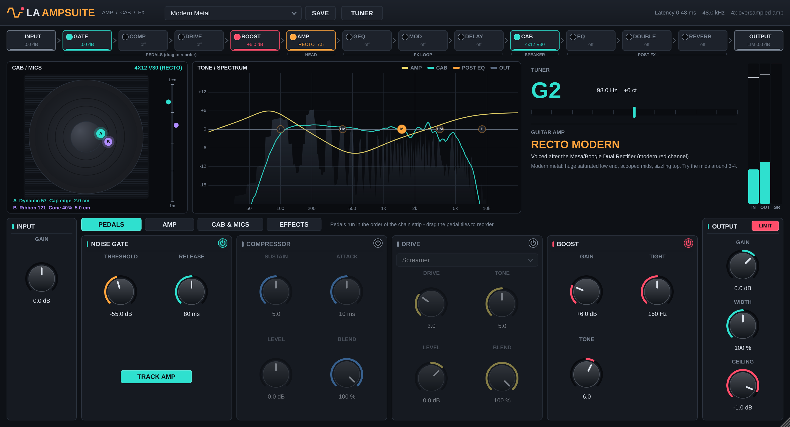
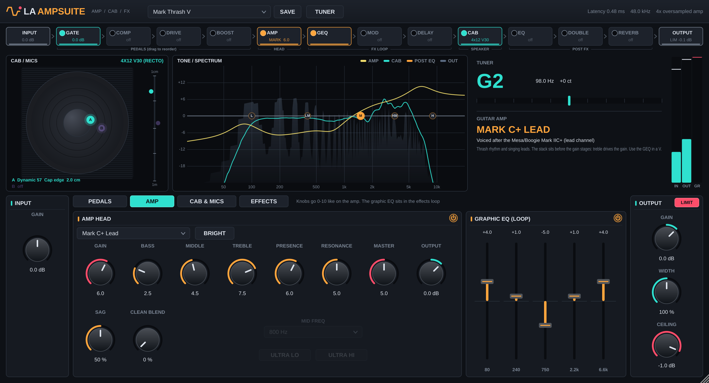
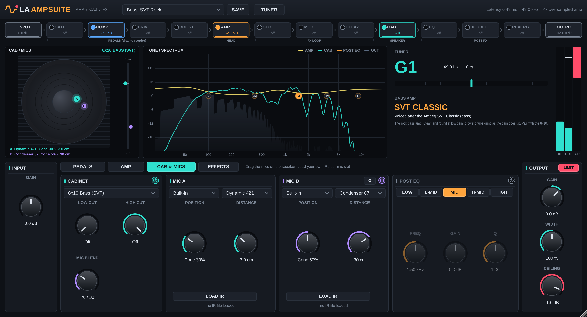
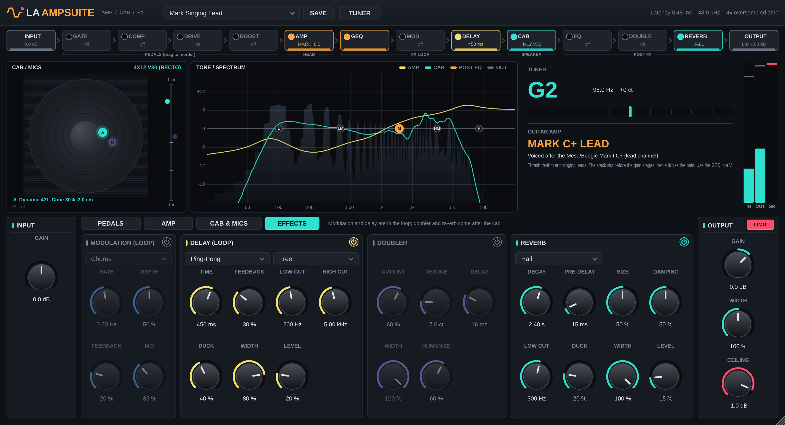

# LA-AmpSuite

A guitar and bass amp suite for Linux (VST3 / LV2 / Standalone), aimed at rock, punk and metal:
pedals, amp heads, effects loop, cabinets with mics or your own impulse responses, and post effects.
It uses the same look as LA-Trigger and LA-VocalChain.



| Amp page | Cab & mics page | Effects page |
|---|---|---|
|  |  |  |

## Signal flow

```
INPUT -> [ GATE  COMP  DRIVE  BOOST ] -> AMP HEAD -> FX LOOP (GEQ, MOD, DELAY) -> CAB (MIC A + MIC B / IRs) -> POST (EQ, DOUBLER, REVERB) -> OUTPUT
          \__ drag to reorder ______/
```

Each stage is a tile in the chain strip at the top. Click a tile's dot to switch the stage on or off.
Click the tile to open its controls. Drag the pedal tiles to change the pedal order. The order is
saved with the session and in presets.

Pedals and the amp run 4x oversampled. Total latency is 23 samples (0.48 ms at 48 kHz), reported to
the host. The cabinet convolution has no extra latency. The whole rig with every stage switched on uses
about 6 % of one CPU core at 48 kHz.

## Amp models

The models are circuit-inspired, not captures. Each one has its own triode cascade (gain per stage,
coupling caps, cathode bypass, Miller roll-off, cold-biased clipper stages), gain pot and bright cap
position, tone stack type and position, cathode follower, power amp drive, presence/resonance, supply
sag and output transformer bandwidth. The passive tone stacks use the third-order analog model of the
treble/middle/bass network (Yeh & Smith, DAFx 2006) with each amp's component values. The tests check this
model against a direct circuit solve.

| Model | Voiced after | Character |
|---|---|---|
| **Brit Plexi** | Marshall 1959 Super Lead (jumpered) | Classic rock crunch. Little preamp gain; push the master for power-amp drive. |
| **Brit 800** | Marshall JCM800 2203 | Punk and hard rock: tight, mid-forward, raspy. Cold-biased clipper stage. |
| **American 51** | Peavey 5150 / 6505 lead channel | Thrash/metal rhythm: four tight stages, post-preamp stack, strong presence/resonance. |
| **Recto Modern** | Mesa/Boogie Dual Rectifier (modern red) | Modern metal: saturated lows, scooped mids, fizz, tube-rectifier sag. |
| **Mark C+ Lead** | Mesa/Boogie Mark IIC+ lead | The tone stack sits *before* the lead cascade (treble drives the gain). Use the GEQ in a V. |
| **SVT Classic** | Ampeg SVT Classic (bass) | Active stack: bass, mid with the 5-position selector (220 Hz – 3 kHz), treble, **Ultra Lo** (+3 dB at 40 Hz, −12 dB at 500 Hz) and **Ultra Hi** (+9 dB at 8 kHz). Big headroom, grind when pushed. |
| **Flip-Top B15** | Ampeg B-15 Portaflex (bass) | Warm, round, vintage; soft tube-rectifier compression. |
| **Bass 400** | Mesa/Boogie Bass 400+ (bass) | Aggressive tube bass with mid punch and grind. |

Every amp has Gain, Bass, Middle, Treble, Presence, Resonance, Master (power-amp drive), Output,
Bright, Sag and **Clean Blend**. Clean Blend mixes the clean low end (below about 180 Hz) under the amp.
That keeps a distorted bass, or a very saturated guitar, tight and full. The models are level-matched
at their default settings.

## Pedals

| Pedal | What it does |
|---|---|
| **Noise Gate** | Keyed from the clean input, with hysteresis and hold. **Track Amp** also closes the gate after the amp (like a "tracking" gate), so amp hiss goes away too. |
| **Compressor** | Sustain (amount), attack, level and blend (parallel compression). |
| **Drive** | *Screamer* (mid-hump overdrive, the classic metal boost), *Distortion* (op-amp into hard clipping diodes), *Fuzz* (two saturated stages, tone sweep), *Bass Drive* (distorts above 250 Hz, keeps the lows clean). Drive, tone, level and blend. |
| **Boost** | Clean boost with **Tight** (high-pass in front of the amp) and a tilt tone. |

## Effects loop

**Graphic EQ**: Mark-style 5 bands at 80, 240, 750, 2200 and 6600 Hz. **Modulation**: chorus, flanger
or phaser. **Delay**: digital, tape, ping-pong or slapback, with tempo sync and ducking.
Modulation and delay are linear, so the engine runs them right after the (also linear) cabinet. The
result is the same as running them before the cab, and it lets them be stereo.

## Cabinet and microphones

Seven built-in cabinets: 4x12 V30 (Recto), 4x12 Greenback (1960), 4x12 T75 (1960A), 2x12 open back,
8x10 bass (SVT), 1x15 bass (B-15) and 4x10 bass with horn. Each one has its box resonance, speaker
voicing and cone breakup.

There are two microphone slots, **A** and **B**, with a blend control. Mic B also has a polarity switch.
Each slot picks one of five mics: Dynamic 57, Dynamic 421, Ribbon 121, Condenser 87 and Dynamic 7B.
- **Position**: from the centre of the dust cap (bright and focused) to the cone edge (darker and
  warmer, with more breakup notches).
- **Distance**: 1 cm to 1 m. Closer mics get more proximity-effect bass. Farther mics pick up the floor
  bounce and the room, and arrive later. Two built-in mics at different distances are time-aligned like
  real mics, so blending them gives the real comb-filter interaction.

To place the mics, drag them on the speaker display. Use the mouse wheel or the rail on the right to set
the distance.

**Your own impulse responses:** set a slot's source to *IR File* and press **LOAD IR**. WAV, AIFF and
FLAC files at any sample rate work (they are resampled), with up to 0.5 s used. IRs are loudness
normalised, so switching between them doesn't jump in level. You can mix a built-in mic with an IR, or
two IRs. The file path is saved with the session and in user presets. Cabinet low cut and high cut
filters come after the mics. Switch the cabinet off to send a DI-style amp signal to an external
cab or IR loader.

The response display shows the amp's tone stack + GEQ (yellow), the cabinet/mic response (teal), the
draggable post EQ (orange) and the output spectrum.

## Post effects and output

5-band **Post EQ** (drag the nodes on the display), **Doubler** (fake double-tracking: the classic wide
rhythm wall), **Reverb** (plate, room, hall, chamber), and an output section with gain, stereo width and a
zero-latency **limiter**.

## Tuner

The chromatic tuner always listens to the input. It covers low B on a 5-string bass (31 Hz) up to the
high frets. Press **TUNER** in the header to mute the output while you tune.

## Presets

16 factory presets. **Guitar**: Default, Classic Rock Crunch, Edge of Breakup, Punk Rock Wall,
Pop-Punk Rhythm, Hard Rock Lead, Thrash Rhythm, Modern Metal, Djent Tight, Mark Thrash V, Mark Singing
Lead, Doom Fuzz. **Bass**: SVT Rock, Punk Grind, Metal Drive, Vintage B-15. **SAVE** stores user
presets (including the pedal order and IR files) in `~/.config/LA Audio/LA-AmpSuite/Presets`.

Tip: aim for DI peaks around −12 to −6 dBFS (watch the IN meter) and adjust the input gain to match
your pickups.

## Building (Linux)

```bash
sudo apt install build-essential cmake ninja-build libasound2-dev libx11-dev libxrandr-dev \
  libxinerama-dev libxcursor-dev libxext-dev libfreetype-dev libfontconfig1-dev libgl1-mesa-dev

cmake -B build -G Ninja -DCMAKE_BUILD_TYPE=Release        # downloads JUCE 8 automatically
cmake --build build -j
xvfb-run -a ctest --test-dir build --output-on-failure    # optional: run the tests

# install
mkdir -p ~/.vst3 ~/.lv2
cp -r build/LAAmpSuite_artefacts/Release/VST3/LA-AmpSuite.vst3 ~/.vst3/
cp -r build/LAAmpSuite_artefacts/Release/LV2/LA-AmpSuite.lv2 ~/.lv2/
```

Options:
- `-DLAAS_JUCE_DIR=/path/to/JUCE` uses a local JUCE checkout.
- `-DLAAS_COPY_AFTER_BUILD=ON` installs the plugins automatically.
- `-DLAAS_ENGINE_ONLY=ON` builds only the DSP engine and its tests (no JUCE needed).

GitHub Actions builds every push and uploads a ready-to-install tarball as an artifact.

## Project layout

```
Source/dsp/ToneStack.*     TMB tone stack (Yeh & Smith analog model, bilinear), SVT / vintage active stacks
Source/dsp/Amp.*           amp model table, triode stages, power amp, sag, output transformer
Source/dsp/Pedals.*        noise gate, compressor, drive (screamer / distortion / fuzz / bass drive), boost
Source/dsp/Cabinet.*       cabinet + mic IR builder (minimum phase, reflections), IR resampling/normalising,
                           zero-latency partitioned convolution with crossfading
Source/dsp/Effects.*       modulation, delay, doubler, reverb (shared with LA-VocalChain)
Source/dsp/Modules.*       post EQ, graphic EQ, limiter
Source/dsp/AmpEngine.*     the whole chain (no JUCE dependency)
Source/dsp/Tuner.h         YIN chromatic tuner
Source/Parameters.*        109 parameters and the factory presets
Source/PluginProcessor.*   JUCE processor: IR builder thread, IR file loading, presets, state
Source/gui/                look and feel, knobs, faders, chain strip, speaker/mic view, response view, tuner
tests/EngineTests.cpp      DSP tests: tone stack vs circuit, model gain/level/aliasing, pedals, gate,
                           cab/mic physics, convolution accuracy and zero latency, IR crossfade, tuner
tests/PluginIntegrationTest  drives processor + editor like a host (presets, state, IR files, CPU); can render screenshots
```

## References used for the voicing

- Rob Robinette, [How the Marshall JCM800 Works](https://robrobinette.com/How_the_Marshall_JCM800_Works.htm) and
  [How the TMB Tone Stack Works](https://robrobinette.com/How_The_TMB_Tone_Stack_Works.htm)
- Duncan Amps, [Tone Stack Calculator](https://duncanamps.com/tsc\index.html) / [Tone Stacks](https://duncanamps.com/technical/tonestack.html)
- Ampeg [SVP-PRO manual](https://ampeg.com:443/pdf/SVP-PRO.pdf), [SVT-CL manual](https://cf3.zzounds.com/media/SVT-CL-cbb1b7084a8447f0e8713f73c2d261b2.PDF)
  (5-position mid, Ultra Lo / Ultra Hi)
- Microphone placement: [Sound On Sound](https://www.soundonsound.com/techniques/understanding-recording-guitar-speakers),
  [Premier Guitar: Amp Micing vs Impulse Responses](https://www.premierguitar.com/articles/Amp_Micing_vs_Impulse_Responses),
  [Sweetwater: how to mic a guitar amplifier](https://www.sweetwater.com/insync/how-to-mic-a-guitar-amplifier/)
- D. Yeh, J. O. Smith, "Discretization of the '59 Fender Bassman Tone Stack", DAFx 2006

Component values for the Peavey and Mesa stacks are approximations (published schematics vary), so
treat those models as "in the spirit of" the originals.

## Trademarks and license

Marshall, Peavey, 5150, 6505, Mesa/Boogie, Rectifier, Mark IIC+, Ampeg, SVT, B-15, Celestion, Shure,
Sennheiser, Royer and Neumann are trademarks of their owners. They are named only to describe the sounds
these models are voiced after. LA-AmpSuite is not affiliated with or endorsed by any of them.

LA-AmpSuite is built on [JUCE 8](https://juce.com), which is dual-licensed under AGPLv3 or a
commercial license. Distributing builds requires either releasing this code under AGPLv3 or
holding a JUCE commercial license.
